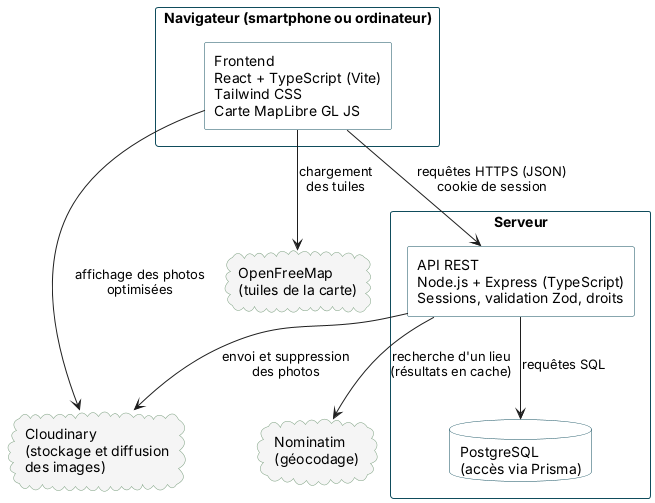
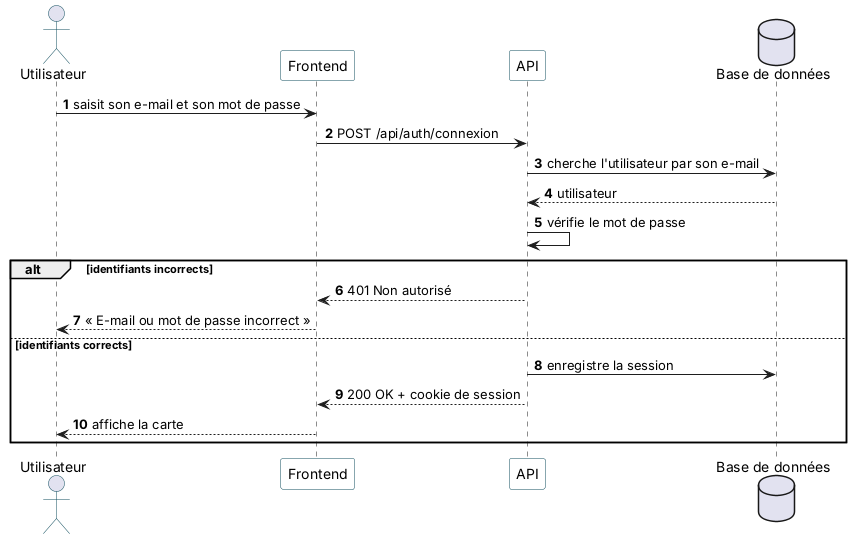
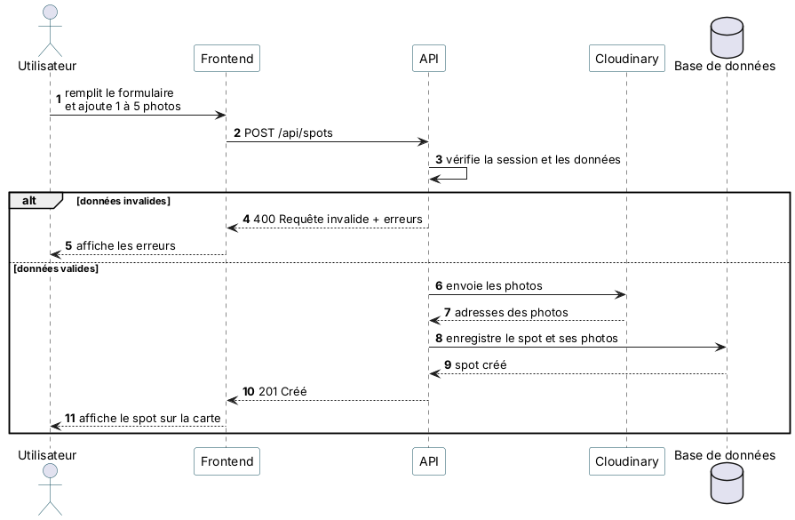

# Conception technique — Spotly

Ce document décrit **comment** Spotly sera construit : l'architecture de l'application, les routes de l'API et le déroulement de deux actions importantes, avec des diagrammes de séquence.

Il s'appuie sur le [cahier des charges technique](Brouillon-cahier-des-charges-tech.md) et sur les [décisions de conception](decisions-de-conception.md), notamment D22 (carte), D23 (authentification), D24 (géocodage) et D25 (validation).

---

## 1. Architecture

*Source du diagramme : [uml/architecture-spotly.puml](uml/architecture-spotly.puml).*

| Composant | Rôle |
| --- | --- |
| **Frontend** (React, TypeScript, Vite, Tailwind, MapLibre) | Affiche l'interface et la carte, vérifie les formulaires et appelle l'API. Il ne contient aucune règle de sécurité. |
| **API REST** (Node.js, Express, TypeScript) | Applique la logique métier : authentification, validation des données, contrôle des droits, accès à la base. C'est la **couche de confiance** de l'application. |
| **PostgreSQL** (via Prisma) | Stocke les données décrites dans le [MPD](mpd.md), ainsi que les sessions. |
| **Cloudinary** | Stocke les photos, les optimise (format et taille adaptés) et les diffuse directement au navigateur. |
| **OpenFreeMap** | Fournit les tuiles du fond de carte, chargées directement par le navigateur. |
| **Nominatim** | Transforme une ville ou une adresse en coordonnées. Il est appelé uniquement par l'API, qui met les résultats en cache. |

**Deux principes :**

- **Le frontend ne parle jamais directement à la base de données.** Toutes les données passent par l'API, qui vérifie la session, les droits et la validité de chaque requête.
- **Les fichiers lourds ne passent pas par le serveur à l'affichage.** Les photos et les tuiles sont chargées directement depuis Cloudinary et OpenFreeMap, déjà optimisées. Seules les données utiles (JSON) passent par l'API.

---

## 2. Routes de l'API

Toutes les routes commencent par `/api`, échangent du **JSON** et sont servies en **HTTPS**.

**Niveaux d'accès :**

- **Public** : accessible sans être connecté ;
- **Connecté** : une session valide est nécessaire (décision D3) ;
- **Auteur** : l'utilisateur doit être le créateur du contenu ;
- **Admin** : l'utilisateur doit avoir le rôle `ADMINISTRATEUR`.

Les droits sont **toujours vérifiés par l'API**, même si l'interface masque déjà les boutons correspondants.

### Authentification

| Méthode | Route | Rôle | Accès | US |
| --- | --- | --- | --- | --- |
| POST | `/api/auth/inscription` | Créer un compte | Public | US-01 |
| POST | `/api/auth/connexion` | Se connecter (tentatives limitées) | Public | US-02 |
| POST | `/api/auth/deconnexion` | Se déconnecter (la session est détruite) | Connecté | US-02 |
| GET | `/api/auth/moi` | Retrouver l'utilisateur connecté à l'ouverture de l'application | Connecté | US-02 |

### Référentiels

| Méthode | Route | Rôle | Accès | US |
| --- | --- | --- | --- | --- |
| GET | `/api/categories` | Liste des catégories | Connecté | US-05, US-07 |
| GET | `/api/tags` | Liste des tags | Connecté | US-05, US-07 |

### Spots

| Méthode | Route | Rôle | Accès | US |
| --- | --- | --- | --- | --- |
| GET | `/api/spots` | Spots publiés d'une zone, avec les filtres (voir ci-dessous) | Connecté | US-03, US-04, US-05, US-16 |
| GET | `/api/spots/:id` | Fiche d'un spot | Connecté | US-06 |
| POST | `/api/spots` | Créer un spot avec 1 à 5 photos (formulaire multipart) | Connecté | US-07 |
| PATCH | `/api/spots/:id` | Modifier un spot | Auteur | US-18 |
| DELETE | `/api/spots/:id` | Supprimer un spot (suppression logique, statut `SUPPRIME`) | Auteur ou admin | US-18 |
| GET | `/api/geocodage?q=` | Trouver les coordonnées d'une ville ou d'une adresse | Connecté | US-04 |

**Paramètres de `GET /api/spots` :**

| Paramètre | Exemple | Rôle |
| --- | --- | --- |
| `ouest`, `sud`, `est`, `nord` | `ouest=6.10&sud=45.88&est=6.16&nord=45.92` | Zone visible de la carte (obligatoire) |
| `temps` | `temps=60` | Temps disponible en minutes : seuls les spots dont `duree_minutes` est inférieure ou égale sont renvoyés |
| `categorie` | `categorie=5` | Filtre par catégorie |
| `tags` | `tags=1,4` | Filtre par un ou plusieurs tags |
| `lat`, `lng`, `distanceMax` | `distanceMax=3000` | Distance maximale en mètres autour d'un point |
| `q` | `q=cascade` | Mot-clé recherché dans le titre et la description |

La réponse ne contient que ce qu'il faut pour afficher les marqueurs et leur aperçu (identifiant, titre, position, catégorie, durée, une photo miniature), et non la fiche complète. Les données transférées restent ainsi légères.

### Favoris

| Méthode | Route | Rôle | Accès | US |
| --- | --- | --- | --- | --- |
| GET | `/api/favoris?page=` | Mes favoris, du plus récent au plus ancien, page par page | Connecté | US-09 |
| PUT | `/api/favoris/:idSpot` | Ajouter un spot à mes favoris | Connecté | US-08 |
| DELETE | `/api/favoris/:idSpot` | Retirer un spot de mes favoris | Connecté | US-08 |

L'ajout utilise `PUT` : envoyer deux fois la même requête (double clic) donne le même résultat, sans créer de doublon. La clé primaire de la table `favori` le garantit aussi en base.

### Administration

| Méthode | Route | Rôle | Accès | US |
| --- | --- | --- | --- | --- |
| GET | `/api/admin/spots?statut=MASQUE` | Liste des spots masqués | Admin | US-17 |
| PATCH | `/api/admin/spots/:id/statut` | Masquer ou republier un spot (`{ "statut": "MASQUE" }` ou `"PUBLIE"`) | Admin | US-17 |

Les routes des évolutions (commentaires, notes, signalements, profil) seront ajoutées avec leurs User Stories, sur le même modèle.

### Codes de réponse

| Code | Signification | Exemple |
| --- | --- | --- |
| 200 | Succès | Fiche d'un spot renvoyée |
| 201 | Ressource créée | Spot créé |
| 204 | Succès sans contenu | Favori retiré |
| 400 | Données invalides | Champ obligatoire manquant, renvoyé champ par champ |
| 401 | Non connecté | Session absente ou expirée |
| 403 | Accès interdit | Modifier le spot d'un autre utilisateur |
| 404 | Introuvable | Spot inexistant, masqué ou supprimé |
| 409 | Conflit | E-mail ou pseudo déjà utilisé |
| 429 | Trop de requêtes | Trop de tentatives de connexion |
| 500 | Erreur du serveur | Erreur d'enregistrement |

Un spot masqué ou supprimé renvoie **404**, et non 403. Pour l'utilisateur, il n'est simplement plus disponible (US-06), et l'API ne révèle pas qu'il existe encore en base.

---

## 3. Diagrammes de séquence

Un diagramme de séquence montre, dans l'ordre, les messages échangés entre l'utilisateur et les différentes parties de l'application pour réaliser une action. Le bloc `alt` représente les deux issues possibles.

### 3.1 Se connecter (US-02)

*Source : [uml/sequence-connexion.puml](uml/sequence-connexion.puml).*

- **Étape 5 :** l'API compare le mot de passe saisi à son empreinte enregistrée (Argon2id). Le mot de passe n'est jamais stocké en clair.
- **Étape 7 :** le message reste le même, que l'e-mail ou le mot de passe soit faux. Un attaquant ne peut donc pas savoir quelles adresses ont un compte.
- **Étapes 8 et 9 :** l'API crée une session et renvoie un cookie `httpOnly`, que le JavaScript de la page ne peut pas lire. Le navigateur le renvoie ensuite à chaque requête, ce qui permet à l'API de savoir qui est connecté (décision D23).

### 3.2 Créer un spot (US-07)

*Source : [uml/sequence-creer-spot.puml](uml/sequence-creer-spot.puml).*

- **Étape 3 :** l'API vérifie que l'utilisateur est connecté, puis valide les données avec Zod : champs obligatoires, coordonnées GPS, 1 à 5 photos au bon format et au bon poids. Le formulaire du frontend fait les mêmes vérifications, mais seule celle de l'API garantit la sécurité.
- **Étapes 6 et 7 :** les photos sont envoyées à Cloudinary, qui les stocke et les optimise. La base n'enregistre que leur adresse et leur identifiant (éco-conception).
- **Étape 8 :** le spot, ses photos et ses tags sont enregistrés dans une **transaction** : tout est enregistré, ou rien. En cas d'erreur, l'API supprime les photos déjà envoyées à Cloudinary.
- **Étape 11 :** le spot est publié immédiatement (décision D4) et apparaît sur la carte.
